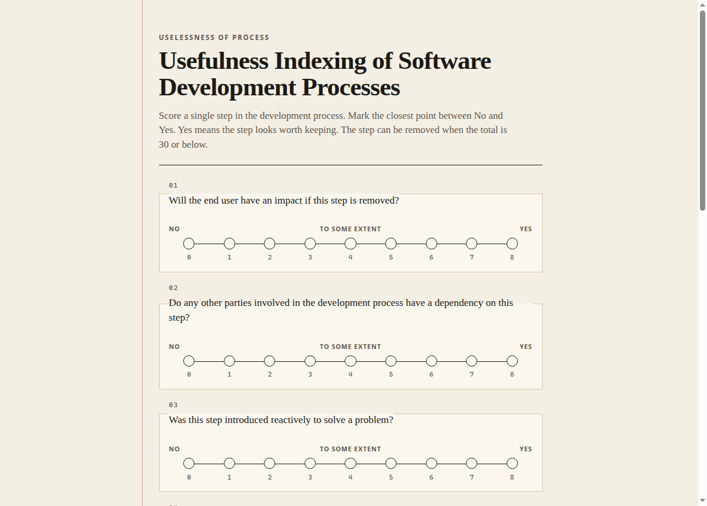
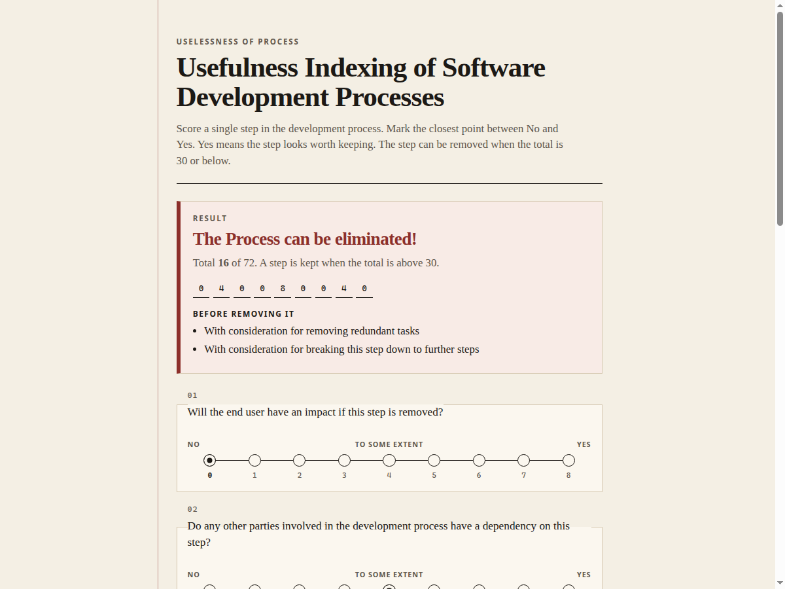

# Uselessness of process

A worksheet for deciding whether one step in a software development process is still worth keeping.

Pranav Prem wrote it in January 2017, as an Excel workbook, after watching process pile up on an Agile team at HSBC Software Development India. Scorecards in wide use then — Gartner function-point analysis and the Magic Quadrant, the Forrester Wave, Whale Path, Capterra — graded whole products, and they tended to justify adding more process. This one looks at a single step, and it is willing to say the step should go.

The original workbooks are still in the repository. The way to run the evaluator today is the Python port below. It asks the same nine questions and applies the same cutoff, with the macro's scoring bugs corrected.

## How it works

You answer nine questions about one step. Each answer sits on a line from **No** (0) to **Yes** (8). **To some extent** is 4. The workbook asked you to put an `A` in the closest column; the port just takes the number. Yes always means the step looks worth keeping.

The nine scores add up to a total between 0 and 72.

- Above 30, the step stays: **The Process can not be eliminated**.
- 30 or below, it can go: **The Process can be eliminated!**

A sheet of all "To some extent" answers totals 36, so a merely middling step is kept. The cutoff sits a little below that, which is the lean of the original tool: removal is the recommendation it is willing to make.

When the step can be removed, a high or low answer can add a caveat. Caveats are withheld when the step is kept. A score of exactly 5 never adds one.

| # | Question | Caveat when the step is removed |
| --- | --- | --- |
| 1 | Will the end user have an impact if this step is removed? | score above 5 |
| 2 | Do any other parties involved in the development process have a dependency on this step? | score above 5 |
| 3 | Was this step introduced reactively to solve a problem? | score above 5 |
| 4 | Are tasks performed in this step unique (i.e. no redundant tasks in any other steps)? | score below 5 |
| 5 | Do the tasks performed in this step necessarily involve manual contribution (cannot be automated)? | score below 5 |
| 6 | Is this step a single unit that can not be broken down into further steps? | score below 5 |
| 7 | Does this step serve a mandatory/regulatory requirement? | score above 5 |
| 8 | Will there be over one Full Time Equivalent man month of effort required to remove/replace this step? | score above 5 |
| 9 | Does this step have an impact on tasks that would help make maintenance easier (logging/documentation)? | score above 5 |

Questions 4, 5, and 6 are worded so that No means the work is redundant, automatable, or splittable. That matches the macro workbook. An earlier draft (the `.xlsx`) asked those two middle questions the other way around, and the macro would have scored them backwards.

Two strings are cleaned up from the sheet. Question 7 originally said "serve to service", and question 9 spelled "maintence". The caveat sentences are the ones the macro wrote, including the last one, which never gained its missing "on".

A step answered `0 4 0 0 8 0 0 4 0` totals 16 and can be removed, with caveats for redundant work and for breaking the step apart. The end user is unaffected, nobody depends on it strongly, it was not a reaction to a problem, it still needs a person, it is cheap to replace, and it does not carry logging or documentation.

## Run it today

Python 3.11 or newer. The program itself uses only the standard library.

```bash
python3 -m venv .venv
source .venv/bin/activate
pip install -e ".[dev]"
```

On Windows, create the environment with `py -m venv .venv` and activate `.venv\Scripts\activate`.

Answer at the prompt:

```bash
python -m uselessness
```

Or pass nine scores, from question 1 to question 9:

```bash
python -m uselessness 0 4 0 0 8 0 0 4 0
python -m uselessness --json 0 4 0 0 8 0 0 4 0
```

Or open the same questionnaire in a browser. It binds to localhost only.

```bash
python -m uselessness --serve
```

Then visit <http://127.0.0.1:8000/>. The page is a plain form: pick one point on each scale and press Evaluate. Nothing is stored.





### The original workbook

`Usefulness of process workbook.xlsm` is the macro workbook (Excel 2016, three sheets):

1. **Info** — how to mark answers, and the title "Usefulness Indexing of Software Development Processes".
2. **Questionnaire** — the nine questions, columns G through O, and an Evaluate button.
3. **Result** — the word RESULT in `I6`, and the sentence written to `I7`.

`Usefulness of process workbook.xlsx` is the earlier draft: five questions filled in, no macro, and the third sheet named Results.

Clicking Evaluate in the `.xlsm` still runs the 2017 macro, which does not match the sheet. It reads rows 1–10 instead of the questions on rows 5–13, scores column G twice, and never reads column O, the Yes column. The last commit in 2017 stopped on a smaller fix: it started looking for `A` instead of `Y`, hid a debug dump into column P, and stopped repeating the first caveat on question 9.

To score inside Excel, import [`workbook/Module1.bas`](workbook/Module1.bas) over `Module1` (or paste it into that module) and use the existing button. Put a single `A` on each question row, in the column closest to your answer. The Python program is the one the tests cover.

The 2017 note still stands: the questionnaire was meant to grow. Adding a question means adding it in `uselessness/evaluate.py`, in the macro, and deciding what a total of 30 means with more than nine answers. The original README pointed that conversation to Pranav Prem (pranavprem93@gmail.com).

## Tech stack

- Python 3.11+ for the port. Continuous integration runs on 3.12.
- No runtime dependencies. pytest 9.1.1 and ruff 0.17.0 are pinned for development.
- The page is server-rendered HTML and CSS from the standard-library HTTP server.
- GitHub Actions runs lint, a format check, and the tests.
- The historical artifact is an Excel 2016 `.xlsm` (VBA) and a `.xlsx` draft.

## Project structure

```
Usefulness of process workbook.xlsm   macro workbook, unchanged
Usefulness of process workbook.xlsx    earlier draft, unchanged
uselessness/
  evaluate.py                          questions, scale, verdict
  cli.py                               prompt, JSON, --serve
  server.py                            localhost questionnaire
  web/                                 page template and stylesheet
workbook/Module1.bas                   corrected Excel macro
tests/                                 scoring, page, and workbook checks
.github/workflows/ci.yml
```

Check and format before sending a change:

```bash
ruff check .
ruff format --check .
pytest
```

## What the macro got wrong

Kept here so the sheet and the program are not confused with each other.

- The scale on the sheet is nine columns, G through O. The macro's loop assigned both of its first two scores to column G and stopped at column N, so a mark in the Yes column added nothing, and a mark in the No column was counted twice.
- Questions occupy rows 5–13. The macro scanned rows 1–10, which includes the header and skips questions 7–9. Caveats were then attached to the wrong rows.
- Empty cells were treated as 0, so the "below 5" caveats appeared even when those questions were blank.
- Several `A` marks on one row were all added into the total.

The port refuses a missing answer, takes one score per question, and reads the scale the headers describe.
